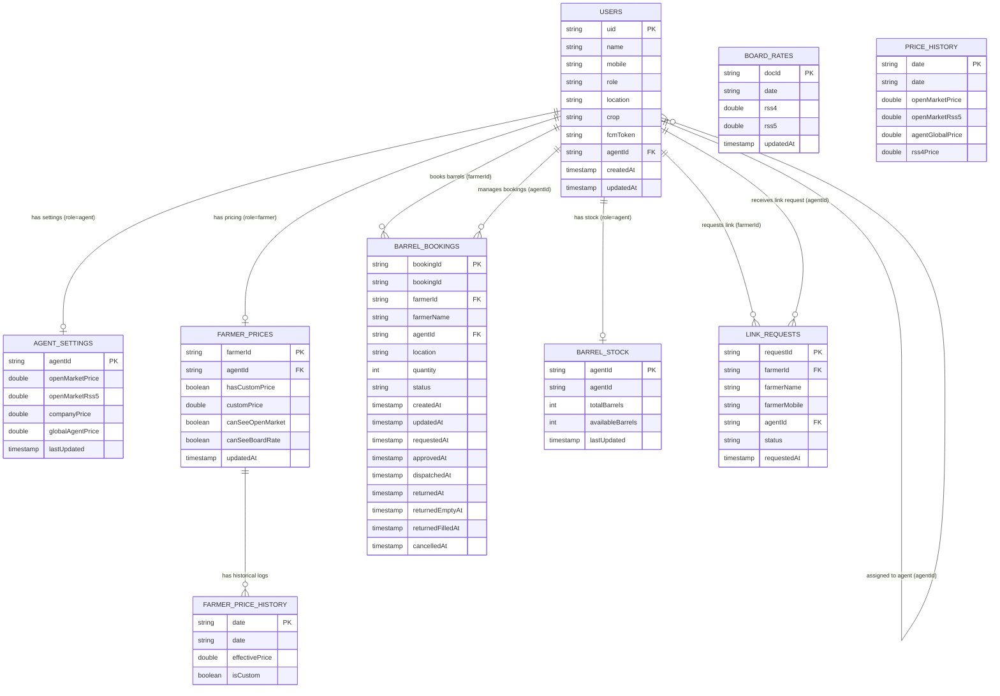

# Krishibhaav Firestore Database Schema Map

This document provides a complete and verified map of the live Firestore database for the Krishibhaav project. The structure and fields documented below are based directly on queries run against the live database, cross-referenced with the Dart model classes and Firebase security rules.

---

## 1. Database Relationship Diagram

The following diagram visualizes how the collections relate to each other. Solid lines represent explicit references (UIDs or document IDs), and dashed lines represent virtual or context-dependent relationships.

---

## 2. Collection Directory & Field Schemas

### 1. `users`
* **Purpose:** Stores profile details, authentication role, and link assignments for both Agents and Farmers.
* **Dart Model:** [UserModel](file:///c:/Joel/Projects/Krishibhaav/lib/models/user_model.dart)
* **Access Control (Plain Language):** 
  * *Read:* Users can read their own document. Agents can read documents of farmers assigned to them (where `agentId` matches the agent's UID).
  * *Create:* Users can create their own document during registration. Agents can create farmer documents.
  * *Update:* Users can update their own profile details but are strictly prevented from escalating their `role` or altering their `agentId`. Agents can update the profiles of their assigned farmers.
  * *Delete:* Agents can delete farmer profiles assigned to them.
* **Read/Write Operations:**
  * *Reads:* Client-side in auth, farmer, and agent screens/providers; Cloud Functions inspect user tokens for FCM dispatches.
  * *Writes:* Client-side `set` on signup or agent farmer creation; client-side `update` for profile editing or FCM token updates; server-side `update` via `acceptLinkRequest` Cloud Function to link `agentId`.

| Field Name | Firestore Type | Model Type | Observed Live? | Notes / Consistency |
| :--- | :--- | :--- | :---: | :--- |
| `uid` | String | String | Yes | Consistent. Matches document ID. |
| `name` | String | String | Yes | Consistent. |
| `mobile` | String | String | Yes | Consistent. |
| `role` | String | String | Yes | Consistent (`'agent'` or `'farmer'`). |
| `location` | String | String | Yes | Consistent. |
| `crop` | String | String | Yes | Consistent (`'Rubber'`). |
| `fcmToken` | String | String | Yes | Consistent (empty string if not initialized). |
| `agentId` | String | String? | Yes | Present only on Farmers. References an Agent's UID. |
| `createdAt` | Timestamp | Timestamp | Yes | Missing on older seed agent records. Model defaults to `Timestamp.now()`. |
| `updatedAt` | Timestamp | Timestamp | Yes | Missing on older seed farmer records. Model defaults to `Timestamp.now()`. |

---

### 2. `agent_settings`
* **Purpose:** Stores pricing configurations set by an Agent for their linked farmers.
* **Dart Model:** [AgentSettingsModel](file:///c:/Joel/Projects/Krishibhaav/lib/models/agent_settings_model.dart)
* **Access Control (Plain Language):**
  * *Read:* Owner agent can read. Farmers linked to this agent can read.
  * *Write:* Only the owner agent can create or update.
* **Read/Write Operations:**
  * *Reads:* Client-side streaming in Agent dashboard and Farmer screens.
  * *Writes:* Client-side `set` during agent signup; client-side `update` when the agent saves new prices.

| Field Name | Firestore Type | Model Type | Observed Live? | Notes / Consistency |
| :--- | :--- | :--- | :---: | :--- |
| *Document ID* | String | String | Yes | Consistent. Matches the Agent's UID. |
| `companyPrice` | Number (Int/Double) | Double | Yes | Consistent. Can be stored as integer depending on input. |
| `openMarketPrice` | Number (Int/Double) | Double | Yes | Consistent (represents RSS4 open market price). |
| `openMarketRss5` | Number (Int/Double) | Double | Yes | Consistent (represents RSS5 open market price). |
| `globalAgentPrice` | Number (Int/Double) | Double | Yes | Consistent (global base agent price). |
| `lastUpdated` | Timestamp | Timestamp | Yes | Consistent. |
| `agentId` | — | String | **No** | **Discrepancy:** The model writes `'agentId'` in `toMap()` but the field is never populated live (it is derived from the document ID in `fromMap`). |

---

### 3. `farmer_prices`
* **Purpose:** Holds customized price overrides and source visibility privileges for specific farmers.
* **Dart Model:** [FarmerPriceModel](file:///c:/Joel/Projects/Krishibhaav/lib/models/farmer_price_model.dart)
* **Access Control (Plain Language):**
  * *Read:* Owner farmer can read. Managing agent can read.
  * *Create/Update/Delete:* Only the managing agent can modify.
* **Read/Write Operations:**
  * *Reads:* Client-side streaming in Farmer home screen, Agent farmer detail sheet, and roster cards; server-side functions read flags before pushing notifications.
  * *Writes:* Client-side `set` (with merge) by Agent when creating farmer or adjusting visibility/custom rates.

| Field Name | Firestore Type | Model Type | Observed Live? | Notes / Consistency |
| :--- | :--- | :--- | :---: | :--- |
| *Document ID* | String | String | Yes | Consistent. Matches the Farmer's UID. |
| `farmerId` | String | String | Yes | Consistent. |
| `agentId` | String | String | Yes | Consistent. References the managing Agent's UID. |
| `hasCustomPrice` | Boolean | Boolean | Yes | Consistent. |
| `customPrice` | Number / Null | Double? | Yes | Consistent. Null if `hasCustomPrice` is false. |
| `canSeeOpenMarket` | Boolean | Boolean | Yes | Consistent. |
| `canSeeBoardRate` | Boolean | Boolean | Yes | Consistent. |
| `updatedAt` | Timestamp | Timestamp | Yes | Consistent. |

#### Subcollection: `history`
* **Path:** `farmer_prices/{farmerId}/history/{date}`
* **Purpose:** Stores the historical effective daily price logs for a specific farmer.
* **Dart Model:** Maps to [PricePoint](file:///c:/Joel/Projects/Krishibhaav/lib/models/price_point.dart)
* **Access Control:** Read allowed for owner farmer and managing agent; writes are blocked entirely (`allow write: if false;` - written via Admin SDK/backend).
* **Read/Write Operations:** Client-side streaming for farmer history charts; written via automated backend.

| Field Name | Firestore Type | Model Type | Observed Live? | Notes / Consistency |
| :--- | :--- | :--- | :---: | :--- |
| *Document ID* | String | String | Yes | Consistent. Date string format (`"YYYY-MM-DD"`). |
| `date` | String | String | Yes | Consistent. |
| `effectivePrice` | Number (Double/Int)| Double | Yes | Consistent. The final price computed for the farmer. |
| `isCustom` | Boolean | — | Yes | Consistent. Indicates if price was custom-overridden. |

---

### 4. `barrel_bookings`
* **Purpose:** Manages the inventory lifecycle requests of physical barrels between Farmers and Agents.
* **Dart Model:** [BarrelBookingModel](file:///c:/Joel/Projects/Krishibhaav/lib/models/barrel_booking_model.dart)
* **Access Control (Plain Language):**
  * *Read:* Owner farmer and assigned agent can read.
  * *Create:* Only the farmer can create a booking for themselves.
  * *Update:* Managing agent can update. Alternatively, the farmer can update if they are setting the status to `'requested'`, `'cancelled'`, `'returned_empty'`, or `'returned_filled'`, provided they change no other fields.
  * *Delete:* Denied.
* **Read/Write Operations:**
  * *Reads:* Client-side streaming in Agent bookings panel and Farmer history.
  * *Writes:* Client-side `set` when requested; client-side updates (wrapped in Firestore Transactions via [BarrelService](file:///c:/Joel/Projects/Krishibhaav/lib/services/barrel_service.dart)) to coordinate status increments and stock alterations.

| Field Name | Firestore Type | Model Type | Observed Live? | Notes / Consistency |
| :--- | :--- | :--- | :---: | :--- |
| `bookingId` | String | String | Yes | Consistent. Matches document ID. |
| `farmerId` | String | String | Yes | Consistent. References Farmer UID. |
| `farmerName` | String | String | Yes | Consistent. Redundant cache of user name. |
| `agentId` | String | String | Yes | Consistent. References Agent UID. |
| `location` | String | String | Yes | Consistent. Delivery location. |
| `quantity` | Number (Integer) | int | Yes | Consistent. Number of barrels. |
| `status` | String | String | Yes | Consistent. Status values include: `'requested'`, `'approved'`, `'dispatched'`, `'returned'`, `'returned_empty'`, `'returned_filled'`, `'cancelled'`. |
| `createdAt` | Timestamp | Timestamp | Yes | Consistent. |
| `updatedAt` | Timestamp | Timestamp | Yes | Consistent. |
| `requestedAt` | Timestamp | Timestamp | Yes | Consistent. |
| `approvedAt` | Timestamp | Timestamp? | Yes | Present only after agent approval. |
| `dispatchedAt` | Timestamp | Timestamp? | Yes | Present only after agent dispatch. |
| `returnedAt` | Timestamp | Timestamp? | Yes | Present after return (legacy status). |
| `returnedEmptyAt` | Timestamp | Timestamp? | Yes | Present after return empty (Path A). |
| `returnedFilledAt` | Timestamp | Timestamp? | Yes | Present after return filled (Path B). |
| `cancelledAt` | Timestamp | Timestamp? | No | Observed in model and rules, but not in active live samples. |
| `cancelReason` | — | String? | No | Defined in model but not observed in live samples. |

---

### 5. `barrel_stock`
* **Purpose:** Tracks physical inventory totals and available counts of barrels for each Agent.
* **Dart Model:** [BarrelStockModel](file:///c:/Joel/Projects/Krishibhaav/lib/models/barrel_stock_model.dart)
* **Access Control (Plain Language):**
  * *Read:* Owner agent or any farmer linked to this agent can read.
  * *Create/Delete:* Only the owner agent can create or delete.
  * *Update:* Owner agent can update. Linked farmers can update only if they keep `totalBarrels` identical and ensure `availableBarrels` does not exceed `totalBarrels` (allows farmers to release stock on booking cancellation/returns).
* **Read/Write Operations:**
  * *Reads:* Client-side streaming in Agent dashboard and inside [BarrelService](file:///c:/Joel/Projects/Krishibhaav/lib/services/barrel_service.dart) transactions.
  * *Writes:* Client-side `update` within transaction during booking approval (deducts stock), cancellation, or returns (restores stock).

| Field Name | Firestore Type | Model Type | Observed Live? | Notes / Consistency |
| :--- | :--- | :--- | :---: | :--- |
| *Document ID* | String | String | Yes | Consistent. Matches the Agent's UID. |
| `agentId` | String | String | Yes | Consistent. References the Agent's UID. |
| `totalBarrels` | Number (Integer) | int | Yes | Consistent. |
| `availableBarrels` | Number (Integer) | int | Yes | Consistent. Must be `<= totalBarrels`. |
| `lastUpdated` | Timestamp | Timestamp | Yes | Consistent. |

---

### 6. `board_rates`
* **Purpose:** Stores the current official Rubber Board prices fetched daily.
* **Dart Model:** [BoardRateModel](file:///c:/Joel/Projects/Krishibhaav/lib/models/board_rate_model.dart)
* **Access Control (Plain Language):**
  * *Read:* Any authenticated user can read.
  * *Write:* Denied (`allow write: if false;` - written via backend scraper).
* **Read/Write Operations:**
  * *Reads:* Client-side streaming for Board Rate card and price feeds.
  * *Writes:* None from the client-side. Written by an automated backend scraper.

| Field Name | Firestore Type | Model Type | Observed Live? | Notes / Consistency |
| :--- | :--- | :--- | :---: | :--- |
| *Document ID* | String | — | Yes | Always `'current'`. |
| `date` | String | String | Yes | Consistent (format: `"YYYY-MM-DD"`). |
| `rss4` | Number (Double) | Double | Yes | Consistent (official RSS4 price). |
| `rss5` | Number (Double) | Double | Yes | Consistent (official RSS5 price). |
| `updatedAt` | Timestamp | Timestamp | Yes | Consistent. |

---

### 7. `price_history`
* **Purpose:** Stores historical daily open market and global agent price points.
* **Dart Model:** [OpenMarketPricePoint](file:///c:/Joel/Projects/Krishibhaav/lib/models/open_market_price_point.dart) & [PricePoint](file:///c:/Joel/Projects/Krishibhaav/lib/models/price_point.dart)
* **Access Control (Plain Language):**
  * *Read:* Any authenticated user can read.
  * *Write:* Denied (`allow write: if false;` - written via backend scraper).
* **Read/Write Operations:**
  * *Reads:* Client-side streaming to populate historical open-market trend line charts.
  * *Writes:* None from client. Written by backend scraper.

| Field Name | Firestore Type | Model Type | Observed Live? | Notes / Consistency |
| :--- | :--- | :--- | :---: | :--- |
| *Document ID* | String | String | Yes | Date string (`"YYYY-MM-DD"`). Trailing spaces observed on legacy docs. |
| `date` | String | String | Yes | Consistent. |
| `openMarketPrice` | Number (Double) | Double (as `rss4`)| Yes | Consistent (corresponds to RSS4 open market). |
| `openMarketRss5` | Number (Double) | Double (as `rss5`)| Yes | Consistent (corresponds to RSS5 open market). |
| `agentGlobalPrice`| Number (Double) | Double (as `price`)| Yes | Consistent (global agent price at that date). |
| `rss4Price` | Number (Double) | — | Yes | **Legacy field:** Present only on older documents. Replacing field is `openMarketPrice`. |

---

### 8. `link_requests` *(In-Code / Virtual)*
* **Purpose:** Handles pending requests from farmers asking to link with a specific Agent.
* **Dart Model:** None (handled as raw JSON `Map<String, dynamic>` in [AgentProvider](file:///c:/Joel/Projects/Krishibhaav/lib/providers/agent_provider.dart)).
* **Access Control (Plain Language):**
  * **CRITICAL DISCREPANCY:** **There are no match rules for `link_requests` in `firestore.rules`.** By default, Firestore denies all access if no rules match. This means client-side creates from the farmer will FAIL in environments with enforced rules (e.g. production). 
* **Read/Write Operations:**
  * *Reads:* Client-side streaming in Agent's pending requests tab; server-side reads during Cloud Function execution.
  * *Writes:* Client-side `add` from farmer requesting link; server-side updates (`status` = `'accepted'`/`'rejected'`) via Cloud Functions.

| Field Name | Firestore Type | Model Type | Observed Live? | Notes / Consistency |
| :--- | :--- | :--- | :---: | :--- |
| *Document ID* | String | — | **No** | Auto-generated ID. Empty in live database (which is why `listCollectionIds` does not return it). |
| `farmerId` | String | String | No | References requesting Farmer's UID. |
| `farmerName` | String | String | No | Cache of requesting Farmer's name. |
| `farmerMobile` | String | String | No | Cache of requesting Farmer's mobile. |
| `agentId` | String | String | No | References targeted Agent's UID. |
| `status` | String | String | No | `'pending'`, `'accepted'`, or `'rejected'`. |
| `requestedAt` | Timestamp | Timestamp | No | Server timestamp of creation. |

---

## 3. Detailed Relationship Directory

Below is the list of foreign-key-style references mapping the database entities:

1. **`users.agentId` $\rightarrow$ `users.uid`**
   * *Field:* `agentId` (stored in farmer user documents).
   * *Target:* `users` document (where `role == 'agent'`).
   * *Cardinality:* Many-to-One (many farmers linked to one agent).
   * *Enforcement:* Guarded by `users` update rules (prevents farmers from changing their `agentId` directly, while agents can only claim farmers assigned to them). Actual transitions happen securely via the `acceptLinkRequest` Cloud Function.

2. **`farmer_prices.{Document ID}` $\rightarrow$ `users.uid`**
   * *Field:* Document ID of `farmer_prices` document.
   * *Target:* `users` document (where `role == 'farmer'`).
   * *Cardinality:* One-to-One (each farmer has exactly one price preference document).
   * *Enforcement:* Implicit structural enforcement (doc ID matching). Rules verify access by checking `request.auth.uid == farmerId`.

3. **`farmer_prices.agentId` $\rightarrow$ `users.uid`**
   * *Field:* `agentId` inside the `farmer_prices` document.
   * *Target:* `users` document (where `role == 'agent'`).
   * *Cardinality:* Many-to-One (many custom farmer pricing records managed by one agent).
   * *Enforcement:* Enforced client-side during registration; rules verify the agent owns the document for edits.

4. **`agent_settings.{Document ID}` $\rightarrow$ `users.uid`**
   * *Field:* Document ID of `agent_settings` document.
   * *Target:* `users` document (where `role == 'agent'`).
   * *Cardinality:* One-to-One (each agent has exactly one global pricing settings document).
   * *Enforcement:* Document ID mapping. Rules verify `request.auth.uid == agentId` for write actions.

5. **`barrel_bookings.farmerId` $\rightarrow$ `users.uid`**
   * *Field:* `farmerId` in `barrel_bookings` document.
   * *Target:* `users` document (where `role == 'farmer'`).
   * *Cardinality:* Many-to-One (a farmer can make multiple barrel booking requests over time).
   * *Enforcement:* Rules enforce `request.auth.uid == request.resource.data.farmerId` on create, preventing users from creating bookings under other farmers' UIDs.

6. **`barrel_bookings.agentId` $\rightarrow$ `users.uid`**
   * *Field:* `agentId` in `barrel_bookings` document.
   * *Target:* `users` document (where `role == 'agent'`).
   * *Cardinality:* Many-to-One (multiple bookings are queued under a single agent).
   * *Enforcement:* Conventional mapping. Rules verify `request.auth.uid == resource.data.agentId` to grant edit privileges (like approve/dispatch) to the agent.

7. **`barrel_stock.{Document ID}` $\rightarrow$ `users.uid`**
   * *Field:* Document ID of `barrel_stock` document.
   * *Target:* `users` document (where `role == 'agent'`).
   * *Cardinality:* One-to-One (each agent holds a single stock count record).
   * *Enforcement:* Document ID mapping. Rules verify `request.auth.uid == agentId` for create/delete, and check agent assignment before allowing updates.

8. **`link_requests.farmerId` $\rightarrow$ `users.uid`**
   * *Field:* `farmerId` inside the request document.
   * *Target:* `users` document (where `role == 'farmer'`).
   * *Cardinality:* Many-to-One (multiple requests can exist over time, though only one is active/pending).
   * *Enforcement:* Validated server-side in `acceptLinkRequest` / `rejectLinkRequest` Cloud Functions.

9. **`link_requests.agentId` $\rightarrow$ `users.uid`**
   * *Field:* `agentId` inside the request document.
   * *Target:* `users` document (where `role == 'agent'`).
   * *Cardinality:* Many-to-One (an agent receives link requests from multiple farmers).
   * *Enforcement:* Validated server-side in `acceptLinkRequest` / `rejectLinkRequest` Cloud Functions.

---

## 4. Key Discrepancies & Live Data Drift

1. **Missing Rules for `link_requests`:**
   * **Problem:** There is no matcher for `/link_requests/{requestId}` in `firestore.rules`.
   * **Impact:** Any client-side write (such as the one in [RequestLinkScreen](file:///c:/Joel/Projects/Krishibhaav/lib/screens/farmer/request_link_screen.dart#L68)) will trigger a `PERMISSION_DENIED` error in production or in an emulator enforcing rules.
   * **Test Suite Fail:** This explains why the security test `'should DENY a farmer from self-creating a link_requests doc with status "accepted"'` would fail at the `assertSucceeds` sanity check (it expects creating a `'pending'` request to succeed, but the rules block it).

2. **Legacy Document IDs and Whitespace in `price_history`:**
   * **Problem:** There are duplicate documents for June 5, 2026. One document ID is `"2026-06-05"` and another is `"2026-06-05 "` (containing a trailing space). 
   * **Schema Drift:** The trailing space document uses the legacy field name `rss4Price`, while the correct document uses the new schema fields (`openMarketPrice`, `openMarketRss5`, `agentGlobalPrice`). This shows historical data drift.

3. **`agentId` Field Absence in `agent_settings`:**
   * **Problem:** The `AgentSettingsModel` writes `'agentId'` in its `toMap()` method, but the live document `8nMlNR4xOXPEC4QTH1uZ206VEiR2` in `agent_settings` does not contain an `agentId` field.
   * **Reason:** The client services (`AgentService` and `AuthService`) manually construct fields during writes (`set`/`update`) rather than calling `toMap()`, resulting in the `agentId` field being omitted (which is acceptable since it is already the document ID).

4. **Missing Timestamps on Older Documents:**
   * **Problem:** Older user records do not contain `createdAt` or `updatedAt` (e.g. Agent `8nMlNR4xOXPEC4QTH1uZ206VEiR2` has neither; farmer `p3OJE4F3RKerIlSxDGugNUdAgy93` is missing `updatedAt`).
   * **Handling:** The Flutter model's `fromMap()` handles this by defaulting missing values to `Timestamp.now()`.
