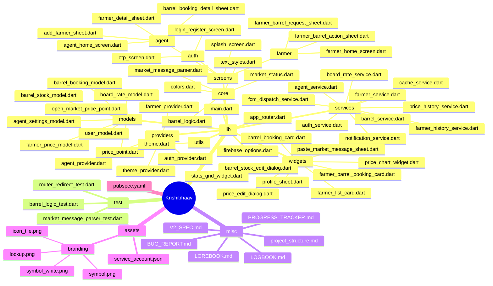
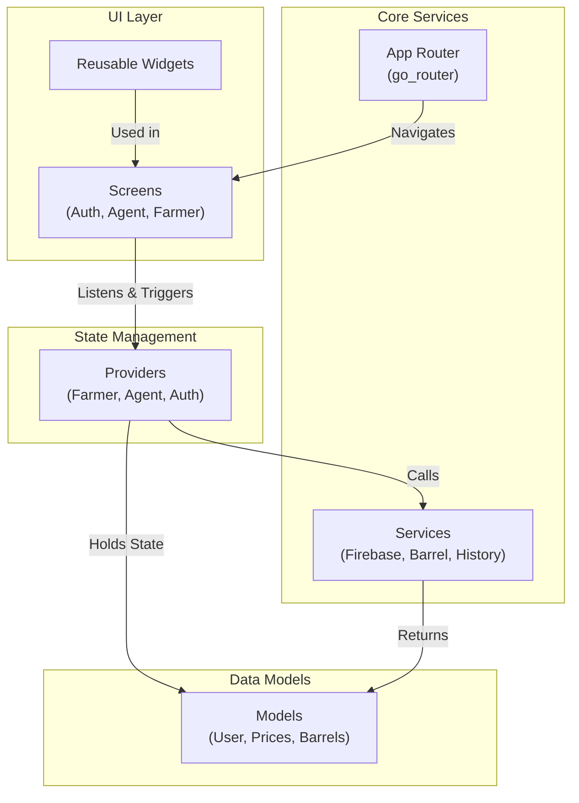

# Krishibhaav Project Structure

Here is a visual map of the current directory structure, focusing heavily on the `lib` codebase since it is the core of the Flutter application.

## Directory Mindmap

## Architectural Flow Graph

